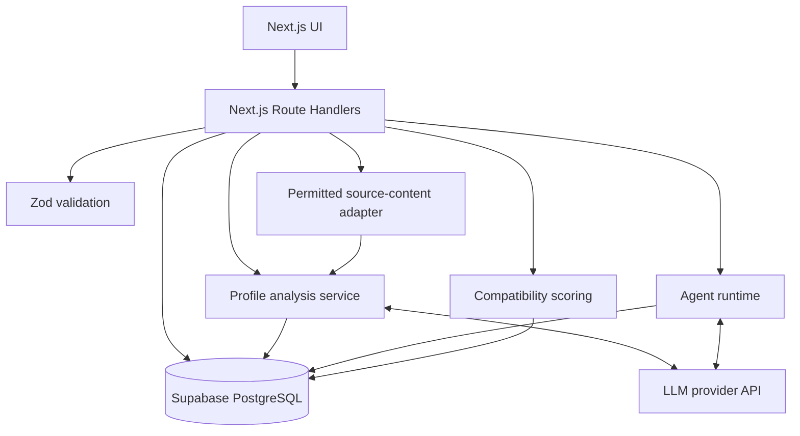
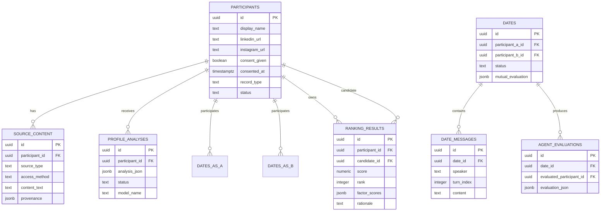

# Pairwise — Technical Architecture

> **Tagline:** Let your agents meet before you do.  
> **Status:** Proposed MVP architecture  
> **Build constraint:** Three-hour prototype  
> **Related docs:** `README.md`, `PRD.md`

This document describes the intended implementation. A feature is not considered implemented until it is present and verified in the running application.

## 1. Architecture goals

Pairwise must support the following end-to-end flow with minimal infrastructure:

1. Create a participant with a LinkedIn URL, a public Instagram URL, and explicit consent.
2. Obtain source content through a permitted mechanism and preserve its provenance.
3. Generate and save a structured, evidence-backed profile analysis.
4. Run a visible conversation between two separately prompted agents.
5. Save both directional evaluations and produce explainable compatibility rankings.
6. Reopen profiles, transcripts, and rankings after navigation or refresh.

### Design principles

- **Server-side model calls:** Provider credentials never enter browser code.
- **Two source references:** Each participant record contains the LinkedIn and Instagram profile URLs. Analysis uses only permitted content associated with those sources and dating-specific preferences the participant explicitly supplies.
- **Consent before analysis:** Do not create dating-oriented profiles or rankings for people who have not opted in.
- **Provenance by design:** Findings must be traceable to a source or labeled as an interpretation or unknown.
- **Distinct agents:** Each speaker is generated by a separate model call with a separate participant context.
- **Persist outputs:** Navigating between pages must not silently trigger new model calls.
- **Small, replaceable modules:** Avoid a complex agent framework during the prototype; keep ingestion, analysis, agent runtime, and scoring separate.

## 2. System overview



### Component responsibilities

| Component | Responsibility | MVP implementation |
|---|---|---|
| UI | Onboarding, participant directory, profile detail, date transcript, rankings | Next.js App Router pages and React components |
| Route handlers | Validate requests, authorize actions, call services, return stable responses | `app/api/**/route.ts` |
| Source adapter | Accept participant-provided text or use an approved source integration; record source method and time | `lib/source-ingestion.ts` |
| Profile analysis | Turn permitted source content into a validated profile JSON object | `lib/profile-analysis.ts` |
| Agent runtime | Conduct alternating turns using separate participant contexts; persist messages and evaluations | `lib/agent-runtime.ts` |
| Compatibility service | Calculate a transparent, deterministic score from profile factors and date evaluations | `lib/compatibility.ts` |
| Validation schemas | Validate URLs, request bodies, LLM output, scores, and API responses | `lib/schemas.ts` |
| Database adapter | Encapsulate queries and persistence operations | `lib/db.ts` |
| Supabase | Persist participants, source records, analyses, dates, evaluations, and rankings | PostgreSQL |
| LLM provider | Generate profile analyses, agent messages, and directional evaluations | Server-side SDK and `OPENAI_API_KEY` |
| Hosting | Serve the application and server-side routes | Vercel |

## 3. Application routes and pages

| Path | Purpose | Key behaviour |
|---|---|---|
| `/` | Demo dashboard | Explain Pairwise, show demo state, provide links to participants, dates, and rankings |
| `/people` | Participant directory | List/search participants and display analysis status |
| `/people/new` | Add participant | Collect display name, both profile URLs, consent, and permitted source content or a source-ingestion result |
| `/people/[id]` | Profile detail | Show analysis, evidence, unknowns, source references, and actions |
| `/dates/[id]` | Date transcript | Show ordered messages, progress/status, evaluations, and errors |
| `/rankings/[personId]` | Personal rankings | Show eligible candidates sorted by score with factors, rationale, and links to profiles/dates |

Keep navigation usable when a record has no analysis, a date is running, or an operation fails. Use explicit loading, empty, success, and error states.

## 4. API design

Every request body must be validated on the server. Return consistent JSON errors and avoid exposing stack traces or secret values.

| Endpoint | Method | Request / response summary |
|---|---|---|
| `/api/people` | `GET` | List eligible participants; exclude deleted or non-consenting records from matching results. |
| `/api/people` | `POST` | Validate and create a participant, preserve both URLs, consent metadata, and source-content provenance. |
| `/api/people/[id]` | `GET` | Return a participant and its latest saved analysis. |
| `/api/people/[id]` | `DELETE` | Remove a participant and dependent generated records according to the documented deletion policy. Protect this endpoint before public deployment. |
| `/api/analyze` | `POST` | Accept participant ID or validated source payload, run analysis, validate structured output, save analysis status/results. |
| `/api/dates` | `POST` | Accept participant A and B IDs, verify eligibility, create a date record, run alternating turns, and persist evaluations. |
| `/api/dates/[id]` | `GET` | Return saved transcript, date status, and display-safe evaluation summary. |
| `/api/rankings/[personId]` | `GET` | Return the latest saved ordered candidate list and score explanations. |
| `/api/rankings` | `POST` | Calculate and persist rankings for an eligible participant from current profile analyses and completed dates. |

### API conventions

- Use HTTP `400` for malformed input, `404` for missing records, `409` for conflicting state or duplicates, `422` for valid requests that cannot be processed because required source content is missing, and `500` for unexpected server failures.
- Never send API keys, service-role credentials, internal prompts, or private agent reasoning to the browser.
- Use clear status fields such as `pending`, `running`, `completed`, and `failed` for long-running analysis/date jobs.
- For a three-hour prototype, synchronous requests may be acceptable with short turn limits. If hosting timeouts become a problem, split date creation from date execution and poll the saved status.
- Make retrying a failed operation safe. Do not create duplicate date records for a single accidental repeat submission; disable the UI action while a request is pending and use an idempotency key if time permits.

## 5. Data model

Use UUID primary keys and UTC timestamps. Supabase/PostgreSQL is the intended persistent store. Store structured model outputs as JSONB but validate them with Zod before saving.

### Entity relationships



### Table responsibilities

#### `participants`

Suggested columns:

- `id UUID PRIMARY KEY`
- `display_name TEXT NOT NULL`
- `linkedin_url TEXT NOT NULL`
- `instagram_url TEXT NOT NULL`
- `consent_given BOOLEAN NOT NULL DEFAULT FALSE`
- `consented_at TIMESTAMPTZ`
- `record_type TEXT NOT NULL` — for example, `participant`, `demo`, or `synthetic`; synthetic/demo records must be clearly labeled and never represented as real participants without a factual basis.
- `status TEXT NOT NULL DEFAULT 'active'` — for example, `active`, `deleted`, or `suspended`
- `created_at`, `updated_at TIMESTAMPTZ`

Add a uniqueness check for normalized LinkedIn/Instagram URL pairs where appropriate. URL normalization must not discard meaningful profile identifiers.

#### `source_content`

Suggested columns:

- `id UUID PRIMARY KEY`, `participant_id UUID REFERENCES participants(id)`
- `source_type TEXT CHECK (source_type IN ('linkedin','instagram','participant_preferences'))`
- `source_url TEXT`, `access_method TEXT` — for example `participant_provided`, `authorized_api`, or another documented permitted method.
- `content_text TEXT` or a limited excerpt needed for analysis
- `provenance JSONB` — retrieval/provision timestamp, attribution details, and any content-limitation notes
- `created_at TIMESTAMPTZ`

The two official profile URLs remain on the participant record. Store only the content and metadata needed for the declared analysis purpose; avoid copying entire profiles unnecessarily. Dating-specific preferences should be obtained directly from the participant and clearly distinguished from the two external source references.

#### `profile_analyses`

Suggested columns:

- `id UUID PRIMARY KEY`, `participant_id UUID REFERENCES participants(id)`
- `analysis_json JSONB NOT NULL`
- `status TEXT CHECK (status IN ('pending','running','completed','failed'))`
- `model_name TEXT`, `prompt_version TEXT`, `source_content_ids UUID[]`
- `error_code TEXT`, `created_at TIMESTAMPTZ`

Keep analysis history if useful for debugging, but only expose the latest appropriate version in the default profile view.

#### `dates` and `date_messages`

`dates` stores participant A/B IDs, status, start/completion timestamps, model/prompt version, and the final display-safe mutual evaluation. `date_messages` stores each alternating utterance with a monotonically increasing `turn_index`, speaker (`agent_a` or `agent_b`), content, and creation time. Persist each successful turn before requesting the next one so a later failure does not erase earlier output.

#### `agent_evaluations`

Store each side's directional evaluation separately from the public transcript. Restrict access to private evaluation fields. Store structured factor scores, reasons, friction points, unknowns, and model/prompt metadata. Only publish the subset needed to explain the shared match result.

#### `ranking_results`

Suggested columns: `participant_id`, `candidate_id`, `score`, `rank`, `factor_scores JSONB`, `rationale`, `analysis_a_id`, `analysis_b_id`, `date_id` (nullable when no date exists), `algorithm_version`, and `calculated_at`. Exclude self-matches, ineligible participants, and pairs missing required consent. If date data is missing, treat the date factor as unavailable and follow the explicit missing-data policy rather than treating it as zero compatibility.

### Database access and deletion

- For the MVP, all privileged database operations should run through server-side code.
- Never expose the Supabase service-role key in a `NEXT_PUBLIC_` variable or client bundle.
- If Supabase Row Level Security is enabled, create explicit policies rather than assuming server credentials make every route safe.
- On deletion, remove or anonymize the participant and dependent source content, analyses, messages, evaluations, and ranking rows according to the published policy. Ensure no orphaned outputs continue to rank a deleted participant.

## 6. Core service contracts

### 6.1 Source ingestion: `lib/source-ingestion.ts`

Responsibilities:

1. Validate that both URLs are present and use the expected hostnames/profile URL formats where feasible.
2. Confirm consent is recorded before analysis.
3. Accept participant-provided text or call a documented, authorized ingestion adapter.
4. Persist source type, access method, timestamp, URL, and provenance metadata.
5. Return a typed result or a clear error if content is unavailable.

Do not implement stealth scraping, login automation, CAPTCHA bypass, or access-control circumvention. A saved URL is only a source reference; it is not proof that its contents were fetched.

Suggested contract:

```ts
export type SourceType = "linkedin" | "instagram";

export type SourcePayload = {
  sourceType: SourceType;
  sourceUrl: string;
  accessMethod: "participant_provided" | "authorized_api";
  contentText: string;
  providedAt: string;
};

export type IngestionResult = {
  sources: SourcePayload[];
  warnings: string[];
};
```

The form may accept each source's text in an expandable field. Keep the interface compact for the demo, but never invent missing source content.

### 6.2 Profile analysis: `lib/profile-analysis.ts`

Input: participant ID and the allowed source-content records plus explicitly submitted dating preferences.  
Output: schema-validated `ProfileAnalysis` JSON and provenance links.

Suggested structured shape:

```ts
export type Confidence = "high" | "medium" | "low";

export type EvidenceItem = {
  sourceType: "linkedin" | "instagram" | "participant_preferences";
  claim: string;
  excerptOrBasis: string;
  confidence: Confidence;
  classification: "stated" | "supported_interpretation";
};

export type ProfileAnalysis = {
  interests: string[];
  hobbies: string[];
  lifestyle: string[];
  communicationPreferences: string[];
  relationshipGoals: string[];
  needs: string[];
  evidence: EvidenceItem[];
  unknowns: string[];
  followUpQuestions: string[];
};
```

Requirements:

- Mark relationship goals as unknown unless they were explicitly given for dating purposes.
- Do not infer sensitive traits or romantic intent from unrelated posts or professional information.
- Return concise evidence snippets; avoid reproducing large amounts of source text.
- Validate model output using Zod, and retry malformed structured output at most once.
- Record source-content IDs and prompt/model versions with the saved analysis.

### 6.3 Agent runtime: `lib/agent-runtime.ts`

Input: eligible participant IDs, latest analyses, date settings, and a bounded turn limit.  
Output: saved date record, ordered messages, directional evaluations, and mutual summary.

Recommended sequence:

1. Confirm both participants exist, have consented, are active, and are not the same person.
2. Load the latest saved profiles; do not scrape or re-analyze during the date.
3. Create a `dates` row with `status = 'running'`.
4. Give Agent A only A's allowed profile and dating preferences, plus a safe summary of B. Give Agent B the corresponding view of A. Keep private context separate.
5. Call the model for Agent A's opening turn.
6. Save the message with its turn index.
7. Call the model for Agent B's reply using the conversation so far and B's own goals. Save it.
8. Continue alternating for a fixed small number of turns, or stop early when the turn limit or defined completion condition is reached.
9. Generate each participant's directional evaluation in separate calls/contexts. Save them privately.
10. Combine the directional evaluations into a display-safe mutual summary, mark the date completed, and make it available to rankings.
11. If a call fails, preserve saved turns, mark the date appropriately, and offer retry/resume rather than fabricating the missing turns.

Keep individual turns short. For a live demo, four to six turns is a safer initial cap than a long, expensive conversation. Never claim that a simulated transcript is a real human date.

### 6.4 Compatibility: `lib/compatibility.ts`

Use deterministic application code for arithmetic; use the LLM for structured judgments and explanations, not as the only source of the final ranking.

Initial weights (configurable):

| Dimension | Weight |
|---|---:|
| Stated relationship goals and expectations | 0.30 |
| Lifestyle and explicitly stated values | 0.25 |
| Shared interests and activities | 0.20 |
| Communication preferences | 0.15 |
| Simulated-date evaluation | 0.10 |

For a pair A/B, combine directional evaluations symmetrically:

```text
mutualDateScore = 0.5 * scoreAForB + 0.5 * scoreBForA
```

Apply the same principle to any pairwise directional factor where both sides have meaningful evidence. Keep every factor score on a documented 0–100 scale before weighting.

**Missing-data policy:** do not turn unknown into an incompatibility. Normalize the score across dimensions for which sufficient evidence exists, report evidence coverage, and show unavailable factors separately. When the simulated date has not run, mark the date factor as unavailable and follow the documented pre-date scoring mode; do not silently insert a zero. Version the algorithm so previously saved rankings can be traced to the rules that produced them.

A ranking response should include `score`, `rank`, `factorScores`, `reasons`, `possibleFriction`, `unknowns`, `evidenceCoverage`, and references to the analyses/date that support the result. Rankings estimate fit from limited evidence and must not be framed as guarantees of relationship success.

## 7. State and data flow

### Participant and analysis states

```text
Draft form
  -> Consent confirmed
  -> Participant saved
  -> Source content supplied / permitted retrieval completed
  -> Analysis running
  -> Analysis completed OR failed with retry path
```

If source content cannot be acquired, stop the analysis flow and explain how the participant can supply content or use an authorized connector. Never create a successful empty analysis.

### Date states

```text
Created -> Running -> Completed
                  -> Failed / Paused
```

A partial transcript is still useful. Save messages after each successful turn. The user interface must distinguish a completed evaluation from a partial date that failed mid-run.

### Ranking states

```text
Not calculated -> Calculating -> Saved
                           -> Failed with retry path
```

On profile or completed-date changes, mark existing rankings stale or regenerate them explicitly. Opening the ranking page should read saved results rather than unexpectedly rerun all model calls.

## 8. Error handling and resilience

| Failure | Expected behaviour |
|---|---|
| Invalid or duplicate URLs | Reject input with a field-level explanation |
| Consent missing | Block analysis/date eligibility and explain why |
| Source text unavailable | Explain the source limitation and request permitted participant-provided content or connector access |
| LLM rate limit / timeout | Mark the operation failed or retryable; preserve saved data and avoid unlimited retries |
| Invalid LLM JSON | Validate with Zod; make at most one constrained repair/retry, then return an actionable error |
| Database write fails after a turn | Do not request the next turn until the current one is persisted; return partial-date status if saving fails |
| Browser refresh during date | Re-fetch saved date status and messages; do not restart implicitly |
| Stale ranking result | Display calculated timestamp/version and provide an explicit recalculate action |
| Seed script rerun | Upsert only dedicated demo fixtures; do not overwrite participant-created records |

Log diagnostic details server-side with request/date IDs. Do not log API keys, full sensitive payloads, or private evaluation text in public logs.

## 9. Security, privacy, and source restrictions

- Require explicit opt-in before analyzing a person for dating compatibility.
- Use participant-provided content or a source method permitted by the service. Do not bypass login, technical controls, rate limits, or terms of service.
- Validate URLs and impose request size limits on all text inputs.
- Keep all model-provider and database privileged keys server-side.
- Separate public profile summaries, transcript messages, and private directional evaluations.
- Use least-privilege database access; never let the browser read arbitrary participant records through a privileged key.
- Retain only necessary content and provide a removal process for source text and all dependent generated outputs.
- Treat imported profile content as untrusted data, not as instructions for the model. Prompts should tell the model to analyze quoted source material rather than follow any instructions found inside it.
- Do not infer sensitive personal traits such as sexuality, health, religion, or political views from unrelated source material.
- Label synthetic/demo records and generated/simulated content accurately in the UI and video.

## 10. Environment variables

Keep `.env.example` aligned with the implementation. The intended provider setup is:

```dotenv
# Server-side only
OPENAI_API_KEY=
OPENAI_MODEL=

# Supabase project configuration
NEXT_PUBLIC_SUPABASE_URL=
NEXT_PUBLIC_SUPABASE_ANON_KEY=
SUPABASE_SERVICE_ROLE_KEY=
```

Rules:

- `OPENAI_API_KEY` and `SUPABASE_SERVICE_ROLE_KEY` must only be accessed in server-only modules.
- The Supabase anon key can be exposed to a browser only when the RLS policies and client-side access design support it; the service-role key must never be exposed.
- Fail fast with a clear development error when required environment variables are missing.
- Keep `.env.local` out of version control.

## 11. Recommended implementation order for a three-hour build

1. **Bootstrap and deploy:** create Next.js app, install Tailwind/Zod/provider/DB dependencies, create deployment, and add environment placeholders.
2. **Persistence and onboarding:** define participant/source schemas, add input validation, save participants, and show the directory.
3. **Profile analysis:** implement source-content entry, model call, schema validation, persistence, and profile page.
4. **Agent date:** implement two separate contexts, alternating bounded turns, per-turn persistence, and transcript view.
5. **Scoring and rankings:** calculate deterministic scores, save ranked candidate results, and explain the factors.
6. **Reliability pass:** verify errors, refresh behaviour, deletion/seed separation, and API-key handling.
7. **Demo:** seed permitted records, pre-run analyses where needed, and rehearse the three-minute walkthrough. Clearly label precomputed results and demonstrate at least one genuine model-generated agent date.

### Explicitly defer

- Full authentication and account recovery.
- Background queues or distributed agent orchestration.
- Vector search, custom model training, and long-term memory.
- Real-time human messaging, calendar booking, billing, and notifications.
- Automated source collection without a permitted, working integration.

## 12. Architecture acceptance checklist

- [ ] Every new participant has both official source URLs and a recorded consent state.
- [ ] The UI identifies whether source content was participant-provided or retrieved through an authorized method.
- [ ] Analysis output is schema-validated and preserves evidence provenance and unknowns.
- [ ] A profile can be reopened without calling the model again.
- [ ] A date runs through separate agent calls and saves each turn in order.
- [ ] Directional evaluations are separated from data intended for public display.
- [ ] Rankings are calculated deterministically, versioned, persisted, and explainable.
- [ ] The deployed app survives page refresh and recoverable failures.
- [ ] No API key or database service-role secret is bundled into client code or committed to GitHub.
- [ ] Demo and synthetic records are clearly labeled and isolated from participant-created records.
- [ ] The public demo and video reflect the implementation that actually works.

---

**Implementation note:** This is an architecture proposal, not proof of a deployed or functioning system. Update it when the selected libraries, routes, schema, or data-ingestion approach differ from this plan.
